# What's PlayblastVR's History?

In its prime, the duo of Domemaster3D/PlayblastVR (and eventually its younger sibling KartaVR) was used commercially by over 175 major VFX, animation, and media companies globally between 2014 - 2018. Some of these projects are visible on the Andrew Hazelden [YouTube collaborations playlist here](https://youtube.com/playlist?list=PLVDcRvd92hci2slU3-UARX9p599UlrY6U&si=8vZBWnKmSccj9Qx_).

PlayblastVR was a common tool used on big projects. This occurred in the prior era of "peak-VR" that existed before major DCC packages added their own native 360VR and fulldome capabilities when things went mainstream.

## PlayblastVR 

### PlayblastVR for Softimage

[PlayblastVR for Softimage](https://www.cgchannel.com/2015/11/andrew-hazelden-releases-playblastvr-for-softimage/) had a unique detail that was mentioned in the press of being the final new plugin delivered commercially to Autodesk Softimage users, in the post-cancellation period of XSI's lifecycle. 

The PlayblastVR port was created to help unify the Domaster3D/PlayblastVR for Softimage user experience, for use by friends like Max Crow at the fulldome show production studio [NSC Creative](https://www.youtube.com/@NSCcreative) in Leicester, UK.

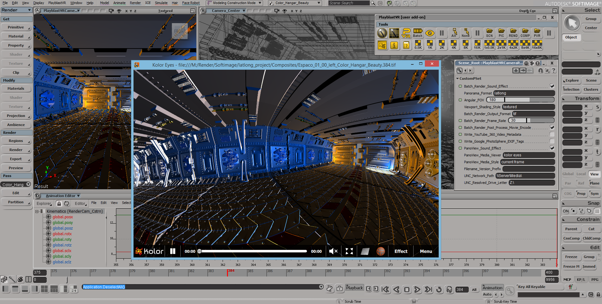
*This is a screenshot of 2014's PlayblastVR for Softimage plug-in*

### PlayblastVR for Maya

PlayblastVR for Maya was created as a companion toolset to the Domemaster3D raytraced lens shaders. This combo of PlayblastVR providing a high speed preview capacity, while Domemaster3D supported offline rendering with a best-in-class programmable omni-stereo lens shader. The lens shaders supported the use ofr texture based "control maps" to sculpt the stereo 3D viewing experience. 

The Domemaster3D toolset existed a full 7 years before most big-box software companies entered the VR zone in the first half of ~2017!

PlayblastVR supported a deep set of features that far exceeded the native playblasting capabilities in Maya for the level of customization and control. PlayblastVR also moved Playblasting over to using the Maya Render Settings window so you could access render output based filename tokens and more. It even allowed for headless batch rendering to occur without having a Maya GUI session active via OpenGL rendering with mayabatch.

You could even tear the PlayblastVR menu system off from the main menu bar to allow you to float the menu onto another monitor. This was handy on dual monitor based Maya workstation configurations.

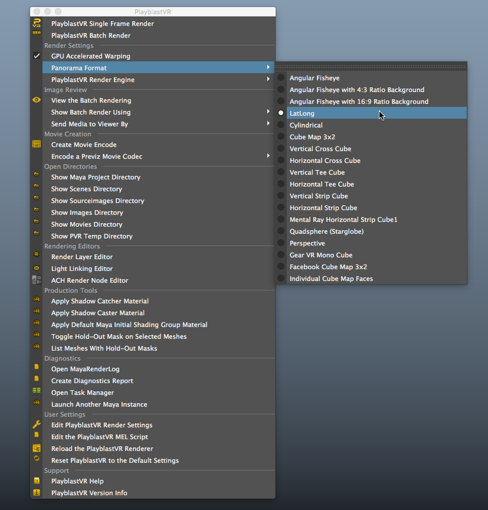

### Rocket Comp for Maya

A Rocket Comp was a pre-compositing companion toolset that worked alongside PlayblastVR for Maya. 

## Domemaster3D

Domemaster3D was a pioneering omni-stereo 3D lens shader toolset that worked with just about every production renderer that supported 3rd party programmable lens shaders. Autodesk Maya, 3ds Max, and Softimage were supported, along with Mental Ray, V-Ray, Maxwell Render, and Arnold running in a wide range of hosts. The 3rd party renderers made it possible to add support for SideX Houdini, and Maxon C4D, too 

## Domemaster3D for Softimage

The Softimage version of Domemaster3D worked with XSI's built-in mental ray renderer. It shipped with a custom toolbar that made it take only a few clicks to get a new immersive rendering set up configured and active. There was a built-in dome viewer toolset for playing back immersive renderings on a preview mesh surface for quick tech-checks.

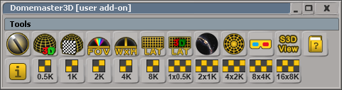

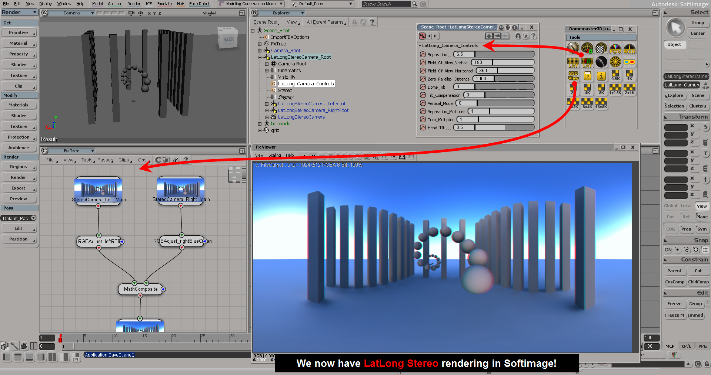

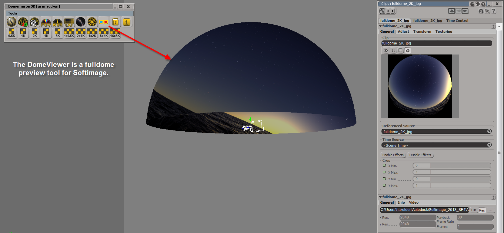

## Domemaster3D for Maya

The Autodesk Maya built-in Arnold and Mental Ray renderers were supported in Domemaster3D for Maya.
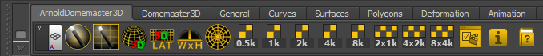

* * *

# Notable Projects

## Art of Patron Tequila VR Experience (2015)

PlayblastVR for Maya was used by [Justin Denton](https://www.justindenton.com/), and [Jared Sandrew](https://www.jaredsandrew.com) on the Art of Patron Tequila VR experience. This was a factory tour video that shows how the iconic drink was produced from the farm, to the factory, to the final drink served to the customer. The project combined the production talents of [Mirada Studios](https://mirada.com/), First Born, and [Legend3D](https://legend3d.com/) to make a pioneering 360VR stereo experience that could be viewed on YouTube in 360VR with a head mounted display.

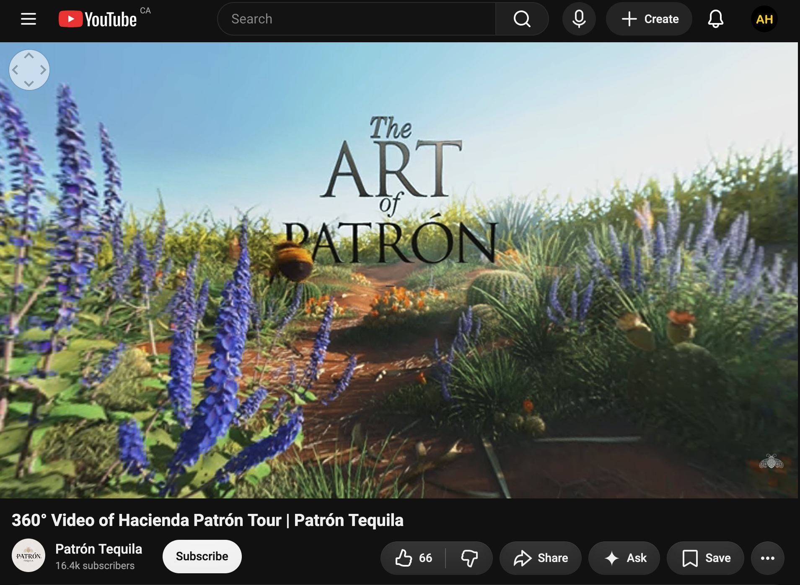

YouTube | 360° Video of Hacienda Patrón Tour | Patrón Tequila  
https://www.youtube.com/watch?v=7NnvksOL96o  

YouTube | Hacienda Patrón Tour | Oculus Virtual Reality Experience 2D | Patrón Tequila  
https://www.youtube.com/watch?v=OJ8A4uAXshc  

The Patrón Oculus Virtual Reality Experience - Behind the Scenes | Patrón Tequila  
https://www.youtube.com/watch?v=s-lAI0GbufQ  

CG Garage Podcast with Justin Denton  
https://www.chaos.com/cg-garage/cg-garage-podcast-33-justin-denton  

## Conan VR Experience (2016)

*This is a screenshot from a Pond5 article "[Inside Conan’s Head: How to Animate Your Own VR Masterpiece](https://blog.pond5.com/9535-inside-conans-head-how-to-animate-your-own-vr-masterpiece/)". It talks about a VR experience created by The Molecule, that used the "PlayblastVR for Maya" plug-in, back in the 2016 era of immersive animation*

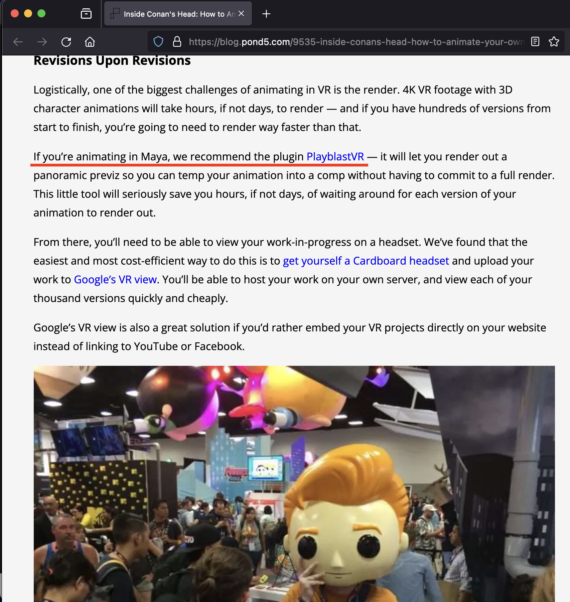

## Boston Museum of Science Fulldome Shows (2012-2018)

Friends at the Boston Museum of Science "Charles Hayden Planetarium" were involved in a lot of Domemaster3D related shared research efforts. This included Jason Fletcher of the "Fulldome Blog" interviewing me back in ~2015.

YouTube | Meet the Director of the Museum of Science Planetarium  
https://www.youtube.com/watch?v=vU92uqa6loU  

The Charles Hayden Planetarium had an in-house fulldome show production team that did amazing work with Maya and Mental Ray to produce educational science documentaries on space. A documentary below shows them at work. If you look closely at Jason Fletcher's monitor during the documentary (timecode 2:47) , you will see the familiar Domemaster3D toolbar running inside of Autodesk Maya on his workstation.

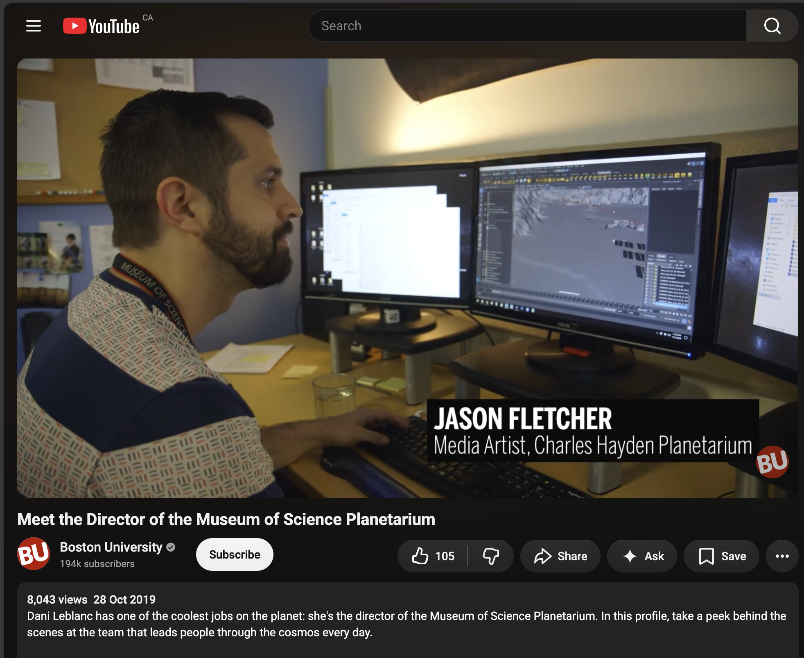

## Rogue One: A Star Wars Story (2016)

PlayblastVR for Maya was used by London's [The Third Floor](https://thethirdfloorinc.com/) team on the Star Wars projects.[Margaux Durand Rival](https://www.imdb.com/name/nm5413863/) a senior previz supervisor at the Third Floor in London used the PlayblastVR for Maya plugin to deliver the 360 degree wrap-around PBR based hardware-rendered virtual production backplates plates that were used extensively in the film inside the XR stage studio.

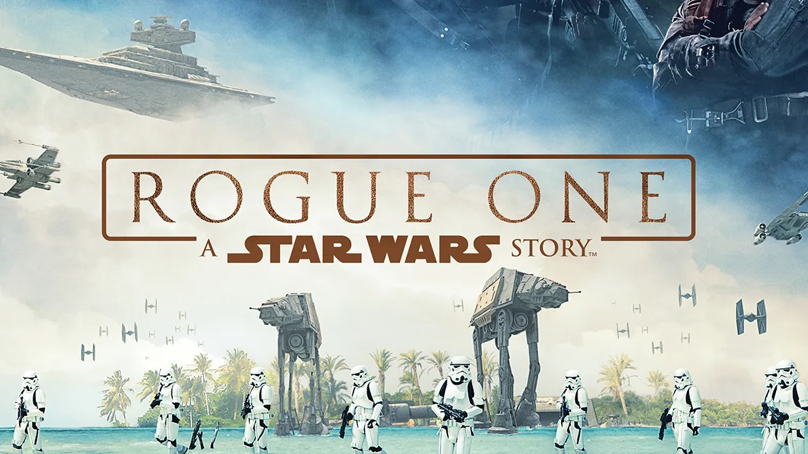

Interestingly, Margaux's input as an end user was the basis of the re-stitching tools that were added to the PlayblastVR Advanced Control panel. Those addition were included with PlayblastVR to help speed up shot delivery time, and allow resuming of an earlier render job via entering the PID code from a prior batch rendering job.

TouchDesigner was used on the Rogue One film project as an "iPad controlled" 2D video player engine on-set. This allowed TouchDesigner to function as a media server that played out the PlayblastVR for Maya created immersive visuals. The wrap-around 360VR footage displayed on the LED video walls for the in-space flight sequence backgrounds that had a pilot in the frame. This was done in conjunction with timed data playback to the motion base so the pilot's acting in the cockpit for the sequence would be responding realistically to the spacecraft's ICVFX (In Camera VFX) produced clips.

Here are trailers that show Stat Wars efforts that PlayblastVR was used on:

Rogue One: A Star Wars Story  
https://www.youtube.com/watch?v=frdj1zb9sMY  

and

Rogue One: Recon - A Star Wars 360 Experience  
https://www.youtube.com/watch?v=Hh8sTR2b4zI  

The Star Wars centric ILM / Third Floor FMX talk a few years later in 2017, had a presentation that disused Rouge One's pioneering Virtual Production techniques with Margaux Durand Rival being a co-presenter along with executive level staff from ILM.

Interestingly, FX Guide in 2016 covered the Rogue One movie and its virtual production efforts, in the article "[Part 1: Rogue One shows its Force](https://www.fxguide.com/fxfeatured/part-1-rogue-one-shows-its-force/)". 

*This is a screenshot from the FXGuide article [Part 1: Rogue One shows its Force](https://www.fxguide.com/fxfeatured/part-1-rogue-one-shows-its-force/).*

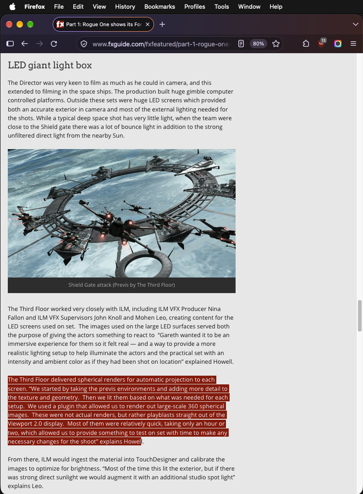

###  The Rogue One Film Predated Unreal Engine 5

Something that is novel to think about is the way the [Rogue One: A Star Wars Story (2016)](https://www.imdb.com/title/tt3748528/) film's pioneering virtual production XR stage LED video wall efforts even predated the industry's milestone release of Unreal Engine 5.0 (April 5, 2022) by many years! UE5, nDisplay, and Disguise would become so entrenched that they would become synonymous with VP.

UE5 was a really big event, for the way it helped bring VP directly into the public consciousness with massive reach and awareness fueled by literal billions spent on development, marketing, and influencer campaigns. And what a time it was to be in the immersive space with so much to see and to do back then! The creative energy in the room, at that time, truly felt electric like anything was possible. Its a rare but wonderful feeling of optimism and enthusiasm felt across an ecosystem.

* * *

Epilogue: About 2 years after the critically acclaimed Rogue One film was released to eager fans, the followup movie "[Solo: A Star Wars Story (2018)](https://www.imdb.com/title/tt3778644/)" was delivered to cinemas. According to [FX Guide, the Han Solo project moved over to using tools like Notch and Disguise](https://www.fxguide.com/fxfeatured/solo-part-2-technical-on-set-immersive-environment/) for their virtual production XR stage efforts.

The Han Solo film was surprisingly, or maybe unsurprisingly, a major box office movie flop that IMHO lacked a lot of the earlier magic and uniqueness... this releases' lackluster performance lead to the inevitable news headlines like [How the Solo: A Star Wars Story Box Office Flop Changed Lucasfilm Forever](https://movieweb.com/solo-star-wars-story-flop-lost-money/).

Really, it just goes to show that sometimes "Lightning in a Bottle" 🌩️ can escape, for a variety of reasons, and what you get in its place is an empty hollow result. That can be seen as a cautionary tale for projects that phone-it-in. 😉
