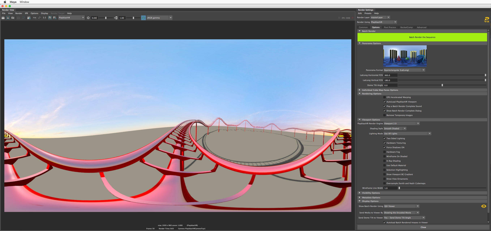
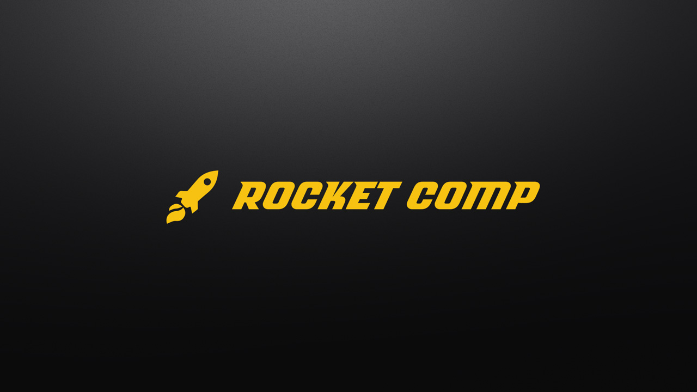

# What's PlayblastVR's History?

In its prime, the duo of Domemaster3D/PlayblastVR (and eventually its younger sibling KartaVR) was used commercially by over 175 major VFX, animation, and media companies globally between 2014 - 2017. Some of these projects are visible on the Andrew Hazelden [YouTube collaborations playlist here](https://youtube.com/playlist?list=PLVDcRvd92hci2slU3-UARX9p599UlrY6U&si=8vZBWnKmSccj9Qx_).

PlayblastVR was a common tool used on big projects. This occurred in the prior era of "peak-VR" that existed before major DCC packages added their own native 360VR and fulldome capabilities when things went mainstream.

## PlayblastVR for Softimage

[PlayblastVR for Softimage](https://www.cgchannel.com/2015/11/andrew-hazelden-releases-playblastvr-for-softimage/) had a unique detail that was mentioned in the press of being the final new plugin delivered commercially to Autodesk Softimage users, in the post-cancellation period of XSI's lifecycle. 

The PlayblastVR port was created to help unify the Domaster3D/PlayblastVR for Softimage user experience, for use by friends like Max Crow at the fulldome show production studio [NSC Creative](https://www.youtube.com/@NSCcreative) in Leicester, UK.

*This is a screenshot of 2014's PlayblastVR for Softimage plug-in*

## PlayblastVR for Maya

PlayblastVR for Maya was created as a companion toolset to the Domemaster3D raytraced lens shaders. 

This combo provided a high speed preview capacity, while supporting offline rendering with a best-in-class programmable omni-stereo lens shader that was brought to market in early 2010 with support for texture based control maps to sculpt the stereo 3D viewing experience. This occurred a full 7 years before most big-box software companies entered the VR zone in the first half of ~2017.

## Rocket Comp for Maya

A Rocket Comp was a pre-compositing companion toolset that worked alongside PlayblastVR for Maya. 

* * *

# Notable Projects

## Conan VR Experience (2016)

*This is a screenshot from a Pond5 article "[Inside Conan’s Head: How to Animate Your Own VR Masterpiece](https://blog.pond5.com/9535-inside-conans-head-how-to-animate-your-own-vr-masterpiece/)". It talks about a VR experience created by The Molecule, that used the "PlayblastVR for Maya" plug-in, back in the 2016 era of immersive animation*

## Art of Patron Tequila VR Experience

PlayblastVR for Maya was used by Justin Denton, and Jared Sandrew on the Art of Patron Tequila VR experience. This was a factory tour video that shows how the iconic drink was produced from the farm, to the factory, to the final drink served to the customer. The project combined the production talents of Mirada Studios, First Born, and Legend3D to make a pioneering 360VR stereo experience that could be viewed on YouTube in 360VR with a head mounted display.

## Rogue One: A Star Wars Story (2016)

FX Guide in 2016 covered the Rogue One movie and its virtual production efforts, in the article "[Part 1: Rogue One shows its Force](https://www.fxguide.com/fxfeatured/part-1-rogue-one-shows-its-force/)". 

The story mentioned, how [Margaux Durand Rival](https://www.imdb.com/name/nm5413863/) a senior previz supervisor at the Third Floor in London used the PlayblastVR for Maya plugin to deliver the 360 degree wrap-around PBR based hardware rendered virtual production backplates plates used extensively in the film inside the XR stage studio. 

Interestingly, Margaux's input as a user was the basis of the re-stitching tools that were added to the PlayblastVR advanced control panel. Those addition were included with PlayblastVR to help speed up shot delivery time, and allow resumable processing via entering the PID code from a prior batch rendering job.

TouchDesigner was used on the Rogue One film project as an "iPad controlled" 2D video player engine on-set. This allowed TouchDesigner to function as a media server that played out the PlayblastVR created immersive visuals, so it was displayed on the LED video walls for the in-space flight sequence backgrounds that had a pilot in the frame. This was done in conjunction with timed data playback to the motion base so the pilot's acting in the cockpit for the sequence would be responding realistically to the space craft's ICVFX clips.

The Star Wars centric ILM / Third Floor FMX talk a few years later in 2017, had a presentation that disused Rouge One's pioneering Virtual Production techniques with Margaux Durand Rival being a co-presenter along with executive level staff from ILM. 

*This is a screenshot from the FXGuide article [Part 1: Rogue One shows its Force](https://www.fxguide.com/fxfeatured/part-1-rogue-one-shows-its-force/).*

Something that is novel to think about is the way Rogue One's pioneering virtual production XR stage LED video wall efforts predated the industry's milestone release of Unreal Engine 5.0 (April 5, 2022) by quite a few years!

UE5 was a really big event, for the way it helped bring VP directly into the public consciousness with massive reach and awareness fueled by literal billions spent on development, marketing, and influencer campaigns. And what a time it was to be in the immersive space with so much to see and to do back then! The creative energy in the room, at that time, truly felt electric like anything was possible. Its a rare but wonderful feeling of optimism and enthusiasm felt across an ecosystem. 😉
